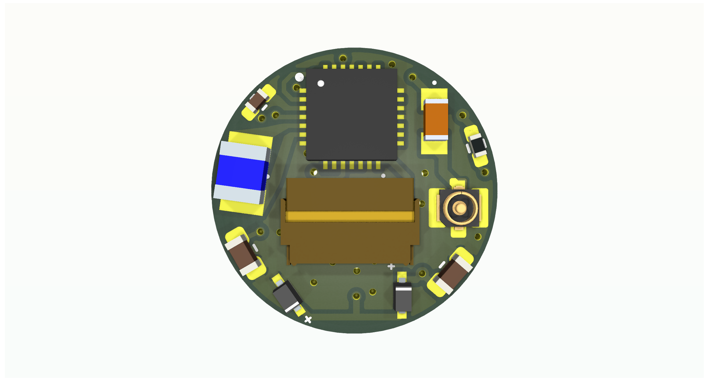

# SiSmaK Piezoelectric Energy Harvesting Module – Battery

Ultrasonic power-receiver module developed for the existing **[SiSmaK](https://www.spp2305.de/sismak/)** sensor-integrated M20 bolt. A piezoelectric receiver converts externally generated ultrasound transmitted through a metallic structure into electrical energy. The circular PCB rectifies and manages this energy, connecting through an **FPC interface** to the existing electronics and rechargeable cell.

Development covered rectifier selection and dimensioning, energy-management configuration, compact PCB layout, and experimental investigation of frequency and electrical load. The tested energy source was an actively driven ultrasonic transmitter.

## Hardware Features

- **Energy Harvesting IC:** e-peas AEM30300
- **Energy Source:** External piezoelectric receiver
- **Rectification:** Greinacher voltage doubler with RB751S40 Schottky diodes and a 100 nF pump capacitor
- **Load Adjustment:** Accessible ZMPP resistor setting for experimental tuning
- **Energy Storage:** Rechargeable cell on the existing SiSmaK electronics
- **Power Management:** Inductive DC-DC conversion with configurable operating parameters
- **Piezoelectric Input:** External piezoelectric transducer connection via MHF4 connector
- **System Interface:** FPC connection to the existing SiSmaK electronics
- **Form Factor:** Compact circular PCB for space-constrained integration

### Piezoelectric Energy Harvesting

The receiver's AC output is rectified before entering the AEM30300. LTspice studies of pump capacitance and load were used to assess its suitability for this application.

The **Greinacher voltage doubler** raises the available DC voltage, while the AEM30300 and external inductor transfer energy to storage. Its ZMPP setting adjusts the effective resistive load at the rectifier output. Because rectifier behavior and source impedance depend on excitation, this setting was evaluated experimentally rather than inferred from the piezo's nominal resonance alone.

The battery buffers surplus energy and supports the existing supply. Unlike the capacitor architecture, this direct-supply variant does not delay load connection until storage has fully charged.

### SiSmaK Integration

The module was designed as an add-on to the existing SiSmaK electronics rather than a standalone development board.

The piezoelectric transducer is connected through a dedicated input connector, while the FPC interface provides the electrical connection to the sensor-integrating bolt system.

## PCB Design

The approximately 13 mm, four-layer PCB was designed in **KiCad 9**. Single-sided component placement limits assembly height; the MHF4 input and FPC interface connect the external receiver and existing SiSmaK electronics.

### PCB View

  

## Hardware Design Documentation

The KiCad schematic and PCB design files are included for further inspection.

[View Hardware Design Documentation (PDF)](Hardware_Design.pdf)

## Design Files

| File | Description |
|---|---|
| `Harvester_Piezo_Akku.kicad_pro` | KiCad project |
| `Harvester_Piezo_Akku.kicad_sch` | Electrical schematic |
| `Harvester_Piezo_Akku.kicad_pcb` | PCB layout |
| `images/Harvester_Piezo_Akku.png` | KiCad 3D rendering |
| `Hardware_Design.pdf` | Schematic and PCB documentation |

## Project Status

The thesis reports storage-charging experiments and SMU load sweeps using piezos bonded to metallic test specimens (§5.3.1). Output exceeded **600 µW at 16 Vpp transmitter drive with 7.2 kΩ ZMPP** in the tested configuration. Narrow frequency maxima and different cold-start/normal-operation load optima made both frequency and load tuning important.

The supply could not start the MCU from empty storage under the investigated low-power conditions. Higher excitation was limited by the AEM30300 input-voltage rating; the thesis reports damage when rectified voltage exceeded 5.5 V without additional protection.
---

**Author:** Alexander Richter  
**Institution:** TU Darmstadt  
**Related project:** [SiSmaK – Project Website](https://www.spp2305.de/sismak/)
