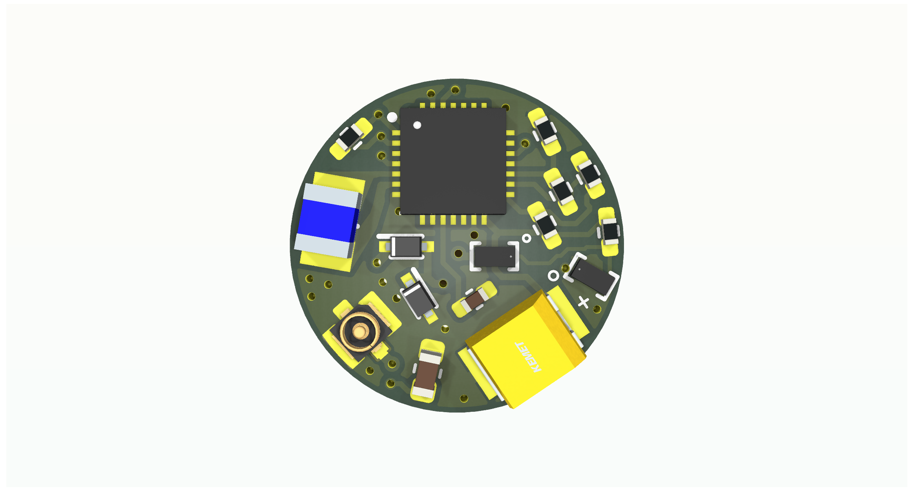

# SiSmaK Piezoelectric Energy Harvesting Module – Capacitor

Custom-designed piezoelectric energy harvesting module for **[SiSmaK](https://www.spp2305.de/sismak/)** (sensor-integrating machine elements). The compact circular PCB connects to the existing SiSmaK electronics via a **flexible printed circuit (FPC)** and provides capacitor-based energy storage for intermittent operation.

The project covers schematic design, component selection, piezoelectric rectification, power management circuitry, and PCB layout for integration into the limited installation space of the sensor-integrating bolt.

## Hardware Features

- **Energy Harvesting IC:** e-peas AEM30300
- **Energy Source:** External piezoelectric transducer
- **Piezoelectric Input:** External transducer connection via MHF4 connector
- **Rectification:** Greinacher voltage-doubler circuit using Schottky diodes
- **Energy Storage:** Capacitor-based energy buffer
- **Power Management:** Inductive DC-DC conversion and storage-voltage monitoring
- **Operating Concept:** Harvest–Store–Use for intermittent operation
- **System Interface:** FPC connection to the existing SiSmaK electronics
- **Form Factor:** Compact circular PCB for space-constrained integration

### Piezoelectric Energy Harvesting

The external piezoelectric transducer generates an alternating electrical signal under mechanical excitation. A Greinacher voltage-doubler circuit rectifies the signal before it is supplied to the AEM30300 energy harvesting IC.

The AEM30300 manages the harvested energy and charges a capacitor. Once sufficient energy has accumulated, the stored energy can be used for a SiSmaK measurement and wireless communication cycle. The circuit also includes a controlled output path for supplying the connected electronics.

### SiSmaK Integration

The module was designed as an add-on to the existing SiSmaK electronics rather than a standalone development board. The piezoelectric transducer connects through an MHF4 connector, while the FPC interface provides the electrical connection to the sensor-integrating bolt system. The FPC connector is visible on the back side of the PCB.

## PCB Design

The PCB was designed using **KiCad 9**, including schematic capture, component placement, and PCB routing.

### PCB View

<table>
  <tr>
    <th align="center">Front Side</th>
    <th align="center">Back Side</th>
  </tr>
  <tr>
    <td width="50%" align="center"></td>
    <td width="50%" align="center"></td>
  </tr>
</table>

## Hardware Design Documentation

The KiCad schematic and PCB design files are included for further inspection.

[View Hardware Design Documentation (PDF)](Hardware_Design.pdf)

## Design Files

| File | Description |
|---|---|
| `Harvester_Piezo_Kondensator.kicad_pro` | KiCad project |
| `Harvester_Piezo_Kondensator.kicad_sch` | Electrical schematic |
| `Harvester_Piezo_Kondensator.kicad_pcb` | PCB layout |
| `images/Harvester_Piezo_Kondensator.png` | Front-side 3D rendering |
| `images/Harvester_Piezo_Kondensator_hinten.png` | Back-side 3D rendering |
| `Hardware_Design.pdf` | Schematic and PCB documentation |

## Project Status

PCB design documented. Manufacturing and hardware validation status are not specified here.

---

**Author:** Alexander Richter  
**Institution:** TU Darmstadt  
**Related project:** [SiSmaK – Project Website](https://www.spp2305.de/sismak/)
