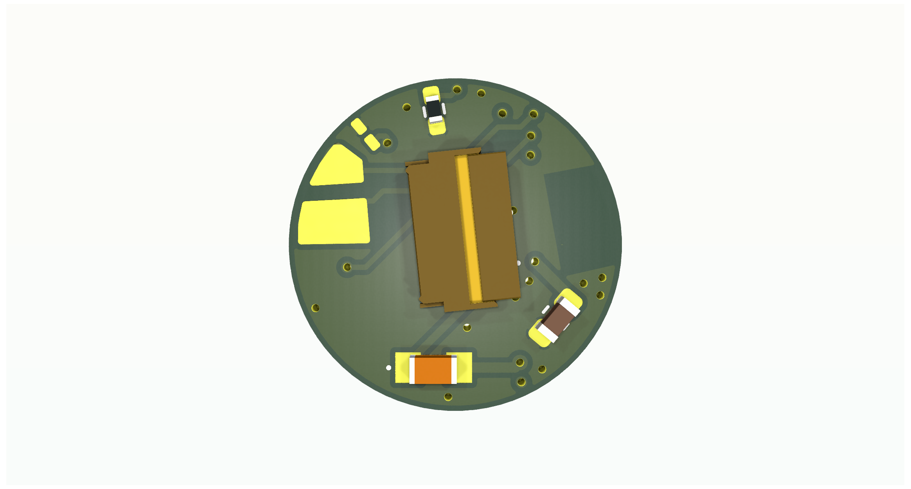

# SiSmaK Piezoelectric Energy Harvesting Module – Capacitor

Capacitor-buffered ultrasonic supply design for the existing **[SiSmaK](https://www.spp2305.de/sismak/)** sensor-integrated M20 bolt. The circular PCB connects through an **FPC interface**, stores energy from an external piezoelectric receiver, and delays load connection until sufficient storage voltage is available.

Development combined rectification and storage circuitry, a controlled output path, compact PCB layout, and firmware adaptations that divide sensor acquisition into tasks separated by recharge pauses.

## Hardware Features

- **Energy Harvesting IC:** AEM30300 in the thesis architecture; supplied IC1 fields are inconsistent (see Project Status)
- **Energy Source:** External piezoelectric transducer
- **Piezoelectric Input:** External transducer connection via MHF4 connector
- **Rectification:** Greinacher voltage-doubler circuit using Schottky diodes
- **Energy Storage:** 150 µF nominal capacitor
- **Power Management:** Inductive DC-DC conversion and storage-voltage monitoring
- **Operating Concept:** Harvest–Store–Partial–Use, retaining RAM during sleep/recharge pauses
- **System Interface:** FPC connection to the existing SiSmaK electronics
- **Form Factor:** Compact circular PCB for space-constrained integration

### Piezoelectric Energy Harvesting

The piezoelectric receiver generates AC under externally driven ultrasonic excitation. A Greinacher voltage doubler rectifies the signal, and the harvesting stage transfers energy to the capacitor.

An ST_STO-controlled PMOS/NMOS output gate keeps the load disconnected during initial charging. Once enabled, the MCU boots and performs individual strain-gauge measurements, entering sleep between tasks while the capacitor recharges. Maintaining the MCU supply preserves RAM and avoids another energy-intensive boot.

### SiSmaK Integration

The module was designed as an add-on to the existing SiSmaK electronics rather than a standalone development board. The piezoelectric transducer connects through an MHF4 connector, while the FPC interface provides the electrical connection to the sensor-integrating bolt system. The FPC connector is visible on the back side of the PCB.

## PCB Design

The approximately 13 mm, four-layer PCB was designed in **KiCad 9**. Two-sided placement accommodates the rectifier, storage, and output-control circuitry; the FPC connector is on the reverse side.

### PCB View

<table>
  <tr>
    <th align="center">Front Side</th>
    <th align="center">Back Side</th>
  </tr>
  <tr>
    <td width="50%" align="center"></td>
    <td width="50%" align="center"></td>
  </tr>
</table>

## Hardware Design Documentation

The KiCad schematic and PCB design files are included for further inspection.

[View Hardware Design Documentation (PDF)](Hardware_Design.pdf)

## Design Files

| File | Description |
|---|---|
| `Harvester_Piezo_Kondensator.kicad_pro` | KiCad project |
| `Harvester_Piezo_Kondensator.kicad_sch` | Electrical schematic |
| `Harvester_Piezo_Kondensator.kicad_pcb` | PCB layout |
| `images/Harvester_Piezo_Kondensator.png` | Front-side 3D rendering |
| `images/Harvester_Piezo_Kondensator_hinten.png` | Back-side 3D rendering |
| `Hardware_Design.pdf` | Schematic and PCB documentation |

## Project Status

The thesis demonstrates phased operation with **150 µF storage** (§5.3.2): charging to about 3.3 V followed by successful MCU boot, with capacitor voltage falling to about 1.7 V. PPK2 recordings, GPIO timing markers, and oscilloscope measurements linked individual tasks to energy use and storage-voltage changes. Reported boot energy was about **0.58 mJ over 24.5 ms**; individual strain-gauge channels required about **0.30 mJ over 14 ms**.

---

**Author:** Alexander Richter  
**Institution:** TU Darmstadt  
**Related project:** [SiSmaK – Project Website](https://www.spp2305.de/sismak/)
