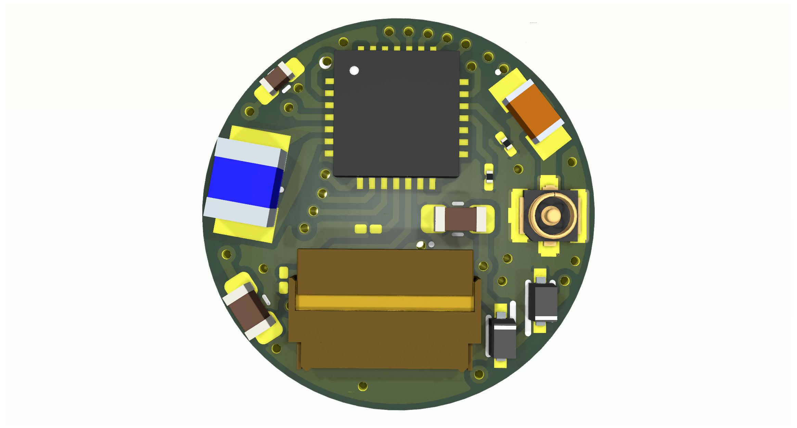
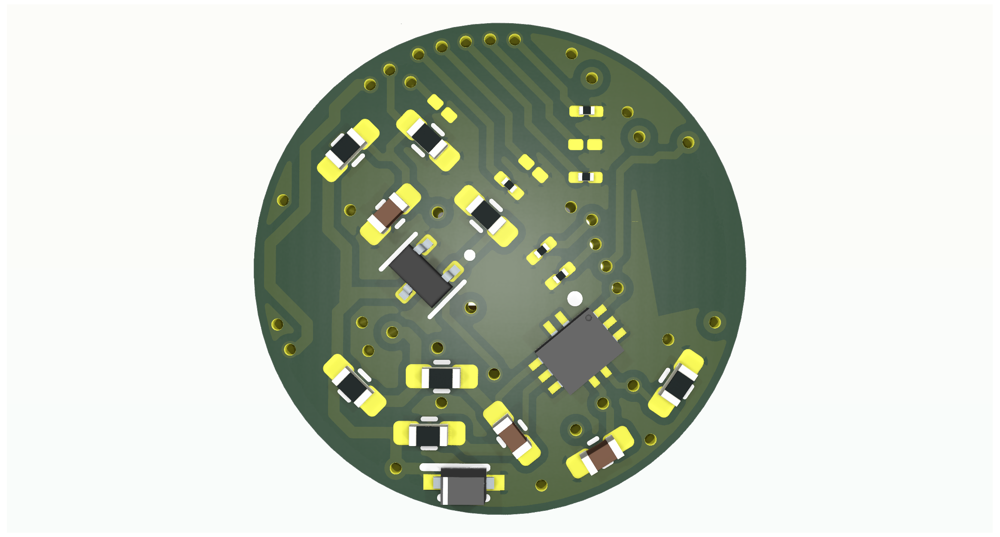

# SiSmaK – Piezoelectric Resonance Measurement Board

Compact harvesting and measurement PCB developed for the [SiSmaK research project](https://www.spp2305.de/sismak/) at TU Darmstadt. It investigates how frequency-search electronics can fit within the approximately 13 mm installation envelope of the sensor-integrated M20 bolt.

The board combines AEM30300 harvesting with switchable measurement paths at the **DC output of the Greinacher rectifier**. Measuring open-circuit voltage and approximate short-circuit current at different excitation frequencies supports ranking of useful ultrasonic operating points without a full load sweep at every frequency.

Development focused on the analog signal paths, MCU-controlled measurement states, and two-sided PCB integration. An FPC interface routes supply, control, and measurement signals to the existing SiSmaK electronics; a separate development board provides access for commissioning and experiments.

## PCB Design

<table>
  <tr>
    <th align="center">Front Side</th>
    <th align="center">Back Side</th>
  </tr>
  <tr>
    <td width="50%" align="center"></td>
    <td width="50%" align="center"></td>
  </tr>
</table>

## Hardware Overview

- **Energy Harvesting IC:** e-peas AEM30300 for piezoelectric energy harvesting and power management.
- **Piezoelectric Input:** External piezoelectric transducer connected through an MHF4 connector.
- **Rectification:** Greinacher voltage doubler using Schottky diodes for converting the piezoelectric AC signal into DC voltage.
- **Current Measurement:** INA190 current-sense amplifier with a 30 Ω shunt; the thesis uses 200 V/V gain.
- **Voltage Measurement:** 6.8 MΩ / 3.3 MΩ divider, approximately 1:3 reduction, with an ADC charge-buffer capacitor.
- **Measurement Control:** MOSFET-based switching circuit for controlling the measurement conditions.
- **System Interface:** FPC connection to the existing SiSmaK electronics, carrying power, measurement signals and control connections.
- **Form Factor:** Compact circular PCB designed for integration into the space-constrained SiSmaK assembly.

## Operating Principle

The circuit separates energy collection from voltage/current characterization so the changing operating state of the harvesting IC has less influence on comparisons between excitation frequencies.

### Piezoelectric Energy Harvesting

The alternating voltage generated by the piezoelectric transducer is rectified using a Greinacher voltage doubler consisting of Schottky diodes and capacitors.

The resulting DC voltage is supplied to the AEM30300 energy harvesting IC, which manages the harvested energy and provides an interface for the connected system.

### Resonance Characterization

The nRF54L15's internal ADC acquires the rectifier-output measurements, avoiding an additional external ADC on the compact module.

- **Open-Circuit Voltage (Voc):** Storage charging is disabled to reduce harvester loading. The AEM30300 remains connected; the thesis found no relevant measurement influence after its supply capacitors had charged.
- **Short-Circuit Current (Isc):** A MOSFET switches the rectifier output through the low-resistance shunt path, and the INA190 amplifies the shunt voltage for ADC acquisition.

The SiSmaK microcontroller controls the measurement circuitry through the FPC interface, switching between open-circuit voltage and short-circuit current measurements. The measured signals are transferred through the same interface for acquisition and processing.

The product **Voc × Isc** is a frequency-ranking criterion, not power delivered into a load: its two factors are measured in different states. The thesis found a close empirical relationship to maximum available power for the investigated configuration (§5.4.1). Divider/filter settling after switching limits measurement speed; amplifier output swing limits the current range.

## Hardware Design Files

The KiCad schematic and PCB design files are included in the project directory for further inspection.

[View Hardware Design Documentation (PDF)](Hardware_Design.pdf)

## Project Context

This PCB was developed as part of research and development activities associated with the [SiSmaK project](https://www.spp2305.de/sismak/) at the Institute of Production Management, Technology and Machine Tools (PTW), TU Darmstadt.

The compact layout establishes the spatial feasibility of the measurement circuit (§5.4.2). Commissioning, firmware integration into the existing SiSmaK project, and experimental frequency sweeps are reported with the development setup (§5.4.3); 