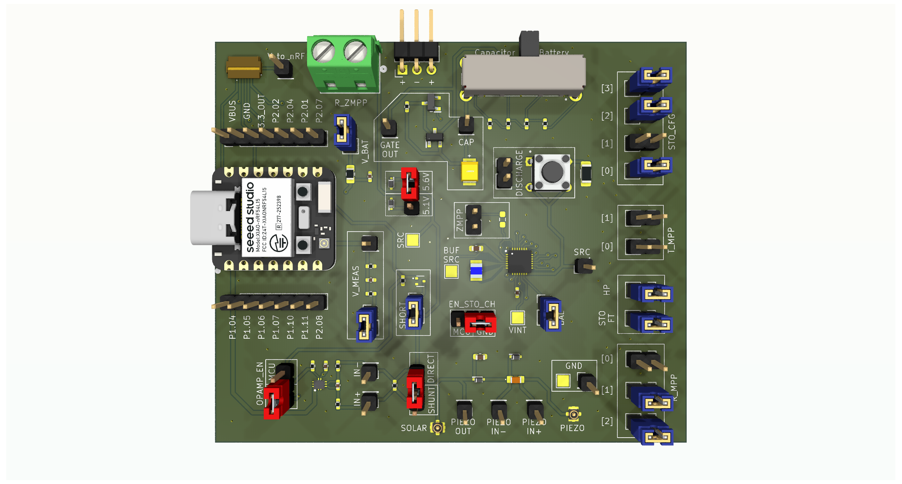

# Piezoelectric Energy Harvesting & Resonance Evaluation Board

Development platform for commissioning ultrasonic harvesting, comparing storage architectures, and evaluating excitation frequencies in the **[SiSmaK](https://www.spp2305.de/sismak/)** project at TU Darmstadt.

  

## Overview

This board makes the compact harvesting and measurement circuit accessible through configuration jumpers, switches, headers, and test points. Development focused on isolating circuit functions for commissioning, adjusting the AEM30300 operating point, and measuring the rectifier's voltage/current response during frequency sweeps.

The board can be used with the **SiSmaK electronics** or with a **Seeed Studio XIAO nRF54L15** development board. The connected microcontroller controls the measurement modes and acquires the measurement signals.

## Hardware Features

- **Energy harvesting IC:** e-peas AEM30300 for piezoelectric energy harvesting, with configurable MPP and storage settings.
- **Piezoelectric input:** External transducer connection via MHF4 connector; additional connection and test points are provided on the development board.
- **Rectification:** Greinacher voltage-doubler rectifier using RB751S40 Schottky diodes, with a rectified output available for the harvester.
- **Energy storage:** Selectable battery or capacitor operation, including a 150 µF capacitor, storage connector, and output gate.
- **Open-circuit voltage (Voc):** High-impedance divider at the Greinacher rectifier's DC output; storage charging is disabled to reduce harvester loading during measurement.
- **Short-circuit current (Isc):** MOSFET-controlled approximate short circuit through a 30 Ω shunt and an INA190 current-sense amplifier.
- **Measurement control:** Microcontroller-controlled switching between operating and measurement conditions; voltage and current signals are routed to the MCU for acquisition.
- **MCU compatibility:** Connections for both the SiSmaK electronics and a Seeed Studio XIAO nRF54L15 development board.
- **Evaluation interfaces:** Jumpers, headers, test points and configuration options for AEM30300 settings, storage selection, and power-path experiments.

## Resonance Search

The MCU switches between voltage and current measurement states and acquires both signals with its internal ADC. The **Voc × Isc** product ranks excitation frequencies; it is not delivered load power, because voltage and current are measured under different conditions. This approach avoids repeating a complete output-load sweep at every frequency.

For **Voc measurement**, the 6.8 MΩ / 3.3 MΩ divider reduces the rectified voltage and a capacitor buffers the ADC input. Disabling storage charging reduces loading; it does not physically isolate the AEM30300. For **Isc measurement**, the switched shunt and INA190 produce an ADC-level signal. Settling after switching is essential for meaningful comparisons.

After commissioning, measurement firmware was developed and integrated into the existing SiSmaK project. A PC program set the signal-generator frequency over a serial interface, issued Bluetooth measurement commands, and collected the MCU results.

## Energy Storage and Operation

The AEM30300 transfers energy from the rectified receiver signal to storage. **Battery-backed** operation retains the direct supply architecture; **capacitor-based** operation adds storage-controlled load connection and supports recharge pauses between tasks. Jumpers and switches allow the harvesting, storage, and output paths to be investigated independently, without the access constraints of the compact module.

## Hardware Design Documentation

The KiCad schematic and PCB design files are included for further inspection.

[View Hardware Design Documentation (PDF)](Hardware_Design.pdf)

## Project

**[SiSmaK – Sensor-integrated machine element](https://www.spp2305.de/sismak/)**  
TU Darmstadt

