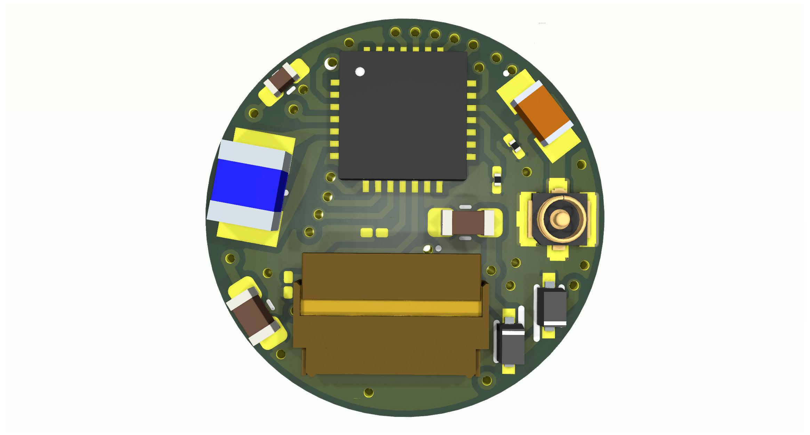
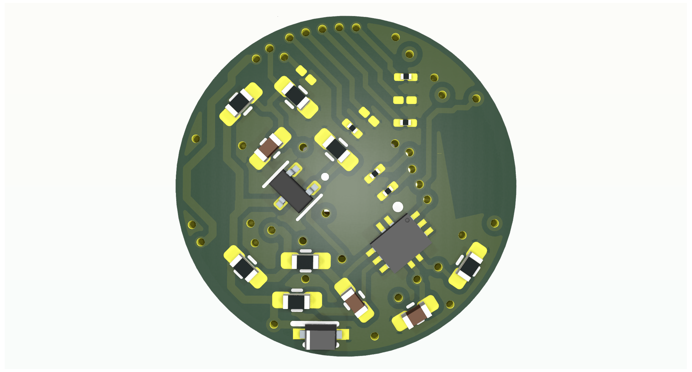

# SiSmaK – Piezoelectric Resonance Measurement Board

This project presents a compact PCB developed for the [SiSmaK research project](https://www.spp2305.de/sismak/) at TU Darmstadt.

The board combines piezoelectric energy harvesting with an integrated measurement circuit for characterizing a piezoelectric transducer. Its primary purpose is to support the identification of the transducer's resonance frequency by measuring its open-circuit voltage and short-circuit current at different excitation frequencies.

The PCB is designed as an extension module for the existing SiSmaK electronics and connects to the main system through an FPC interface.

## PCB Design

| Front View | Back View |
|:---:|:---:|
|  |  |

## Hardware Overview

- **Energy Harvesting IC:** e-peas AEM30300 for piezoelectric energy harvesting and power management.
- **Piezoelectric Input:** External piezoelectric transducer connected through an MHF4 connector.
- **Rectification:** Greinacher voltage doubler using Schottky diodes for converting the piezoelectric AC signal into DC voltage.
- **Current Measurement:** INA190 current-sense amplifier for measuring the current through a shunt resistor.
- **Voltage Measurement:** High-impedance voltage measurement path for monitoring the piezoelectric output voltage.
- **Measurement Control:** MOSFET-based switching circuit for controlling the measurement conditions.
- **System Interface:** FPC connection to the existing SiSmaK electronics, carrying power, measurement signals and control connections.
- **Form Factor:** Compact circular PCB designed for integration into the space-constrained SiSmaK assembly.

## Operating Principle

The board supports two main functions: piezoelectric energy harvesting and electrical characterization of the connected piezoelectric transducer.

### Piezoelectric Energy Harvesting

The alternating voltage generated by the piezoelectric transducer is rectified using a Greinacher voltage doubler consisting of Schottky diodes and capacitors.

The resulting DC voltage is supplied to the AEM30300 energy harvesting IC, which manages the harvested energy and provides an interface for the connected system.

### Resonance Characterization

The integrated measurement circuit enables electrical characterization of the piezoelectric transducer under different excitation frequencies.

- **Open-Circuit Voltage (Voc):** The AEM30300 is disabled during measurement, allowing the piezoelectric voltage to be measured through a high-impedance voltage divider.
- **Short-Circuit Current (Isc):** A MOSFET-controlled low-resistance path enables approximate short-circuit current measurement using a shunt resistor and an INA190 current-sense amplifier.

The SiSmaK microcontroller controls the measurement circuitry through the FPC interface, switching between open-circuit voltage and short-circuit current measurements. The measured signals are transferred through the same interface for acquisition and processing.

By evaluating the measured voltage and current over a frequency sweep, the system can identify resonance-related peaks and determine suitable excitation frequencies for piezoelectric energy harvesting.

## Hardware Design Files

The KiCad schematic and PCB design files are included in the project directory for further inspection.

[View Hardware Design Documentation (PDF)](Hardware_Design.pdf)

## Project Context

This PCB was developed as part of research and development activities associated with the [SiSmaK project](https://www.spp2305.de/sismak/) at the Institute of Production Management, Technology and Machine Tools (PTW), TU Darmstadt.

The design combines compact PCB development, piezoelectric energy harvesting, analog measurement circuitry and embedded-system integration.
