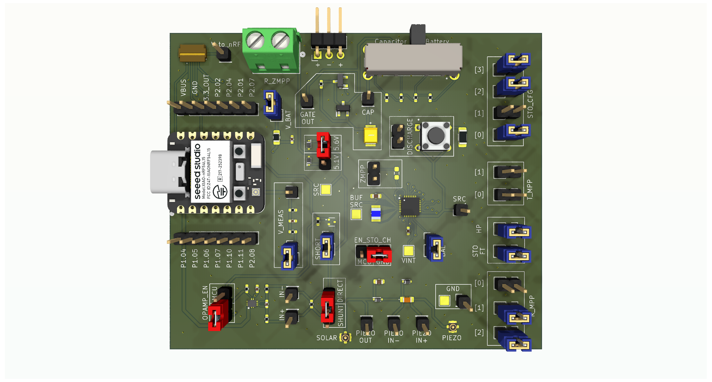

# Piezoelectric Energy Harvesting & Resonance Evaluation Board

Development and evaluation platform for piezoelectric energy harvesting and resonance-frequency search in the **[SiSmaK](https://www.spp2305.de/sismak/)** project at TU Darmstadt.

  

## Overview

This development board combines a piezoelectric energy-harvesting circuit with switchable voltage and current measurement paths. It supports characterization of a piezoelectric transducer during a frequency sweep, evaluation of the AEM30300 harvesting circuit, and experiments with different energy-storage configurations.

The board can be used with the **SiSmaK electronics** or with a **Seeed Studio XIAO nRF54L15** development board. The connected microcontroller controls the measurement modes and acquires the measurement signals.

## Hardware Features

- **Energy harvesting IC:** e-peas AEM30300 for piezoelectric energy harvesting, with configurable MPP and storage settings.
- **Piezoelectric input:** External transducer connection via MHF4 connector; additional connection and test points are provided on the development board.
- **Rectification:** Greinacher voltage-doubler rectifier using RB751S40 Schottky diodes, with a rectified output available for the harvester.
- **Energy storage:** Selectable battery or capacitor operation, with a storage connector and configuration jumpers.
- **Open-circuit voltage (Voc):** A switchable high-impedance voltage-measurement path. The AEM30300 input can be disconnected during measurement, and the piezoelectric voltage is sensed through a resistor divider.
- **Short-circuit current (Isc):** A MOSFET-controlled low-resistance measurement path using a shunt resistor and an INA190 current-sense amplifier.
- **Measurement control:** Microcontroller-controlled switching between operating and measurement conditions; voltage and current signals are routed to the MCU for acquisition.
- **MCU compatibility:** Connections for both the SiSmaK electronics and a Seeed Studio XIAO nRF54L15 development board.
- **Evaluation interfaces:** Jumpers, headers, test points and configuration options for AEM30300 settings, storage selection, and power-path experiments.

## Resonance Search

During a frequency sweep, the microcontroller can switch the board into the required measurement configuration and acquire the piezoelectric transducer's open-circuit voltage or short-circuit current. The resulting frequency-dependent measurements can be used to identify resonance-related peaks and evaluate suitable excitation frequencies for energy harvesting.

For **Voc measurement**, the harvesting input is isolated to reduce transducer loading, and the voltage is acquired via the high-impedance divider. For **Isc measurement**, the MOSFET enables the low-resistance shunt path and the INA190 provides a measurable output signal.

## Energy Storage and Operation

The AEM30300 harvests energy from the rectified piezoelectric signal. The board provides configuration options for **battery-backed** and **capacitor-based** operation, enabling comparison of continuous energy-buffered use and charge/discharge operating cycles. Jumpers and switches allow the harvesting, storage and output paths to be evaluated independently.

## Hardware Design Documentation

The KiCad schematic and PCB design files are included for further inspection.

[View Hardware Design Documentation (PDF)](Hardware_Design.pdf)

## Project

**[SiSmaK – Sensor-integrated machine element](https://www.spp2305.de/sismak/)**  
TU Darmstadt

