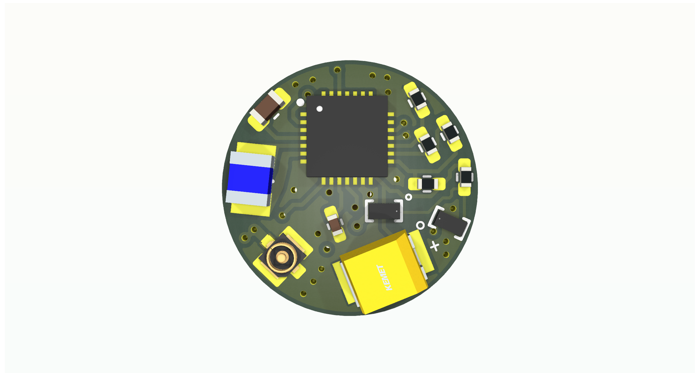

# SiSmaK Solar Energy Harvesting Module – Capacitor

Custom-designed photovoltaic energy harvesting module for **[SiSmaK](https://www.spp2305.de/sismak/)** (sensor-integrating machine elements). The compact circular PCB connects to the existing SiSmaK electronics via a **flexible printed circuit (FPC)** and provides capacitor-based energy storage for intermittent operation.

The project covers schematic design, component selection, power management circuitry, and PCB layout for integration into the limited installation space of the sensor-integrating bolt.

## Hardware Features

- **Energy Harvesting IC:** e-peas AEM10300
- **Energy Source:** External photovoltaic cells
- **Energy Harvesting:** Photovoltaic energy conversion and power management
- **Energy Storage:** Capacitor-based energy buffer
- **Power Management:** Inductive DC-DC conversion with configurable operating parameters
- **Operating Concept:** Harvest–Store–Use for intermittent operation
- **System Interface:** FPC connection to the existing SiSmaK electronics
- **Form Factor:** Compact circular PCB for space-constrained integration

### Photovoltaic Energy Harvesting

The AEM10300 harvests electrical energy from external photovoltaic cells. The circuit integrates the required passive components and configuration connections for energy harvesting and power management.

Unlike the battery-based variant, the harvested energy is temporarily stored in a capacitor. Once sufficient energy is available, the stored energy can be used for a SiSmaK measurement and wireless communication cycle.

### SiSmaK Integration

The module was designed as an add-on to the existing SiSmaK electronics rather than a standalone development board. Its FPC interface provides the electrical connection to the sensor-integrating bolt system. The connector is visible on the back side of the PCB.

## PCB Design

The PCB was designed using **KiCad 9**, including schematic capture, component placement, and PCB routing.

### PCB View

<table>
  <tr>
    <th align="center">Front Side</th>
    <th align="center">Back Side</th>
  </tr>
  <tr>
    <td width="50%" align="center"></td>
    <td width="50%" align="center"></td>
  </tr>
</table>

## Hardware Design Documentation

The KiCad schematic and PCB design files are included for further inspection.

[View Hardware Design Documentation (PDF)](Hardware_Design.pdf)

## Design Files

| File | Description |
|---|---|
| `Harvester_Solar_Kondensator.kicad_pro` | KiCad project |
| `Harvester_Solar_Kondensator.kicad_sch` | Electrical schematic |
| `Harvester_Solar_Kondensator.kicad_pcb` | PCB layout |
| `images/Harvester_Solar_Kondensator.png` | Front-side 3D rendering |
| `images/Harvester_Solar_Kondensator_hinten.png` | Back-side 3D rendering |
| `Hardware_Design.pdf` | Schematic and PCB documentation |

## Project Status

PCB design documented. Manufacturing and hardware validation status are not specified here.

---

**Author:** Alexander Richter  
**Institution:** TU Darmstadt  
**Related project:** [SiSmaK – Project Website](https://www.spp2305.de/sismak/)
