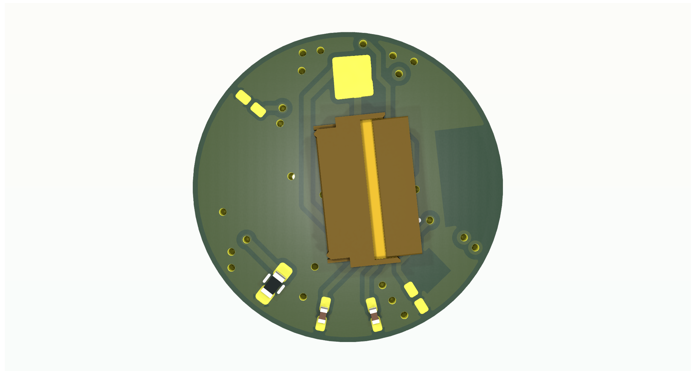

# SiSmaK Solar Energy Harvesting Module – Capacitor

Photovoltaic power-supply design for the existing **[SiSmaK](https://www.spp2305.de/sismak/)** sensor-integrated M20 bolt. The circular PCB connects through an **FPC interface** and accumulates energy in a capacitor before enabling the load. It addresses the repeated startup attempts observed when the battery-buffered supply could not meet MCU boot demand.

Development covered storage sizing, AEM10300 configuration, a transistor output gate, and PCB layout within the approximately 13 mm installation envelope.

## Hardware Features

- **Energy Harvesting IC:** e-peas AEM10300
- **Energy Source:** External photovoltaic cells
- **Operating Point:** FOCV tracking configured to 80% of open-circuit voltage
- **Energy Storage:** 150 µF nominal tantalum capacitor
- **Operating Concept:** Storage-controlled startup, developed toward Harvest–Store–Partial–Use operation
- **System Interface:** FPC connection to the existing SiSmaK electronics
- **Form Factor:** Compact circular PCB for space-constrained integration

### Photovoltaic Energy Harvesting

The AEM10300 charges the storage capacitor. Its ST_STO signal controls a PMOS supply switch through an NMOS driver, keeping the SiSmaK load disconnected during initial charging. The output-gate behavior was investigated in **LTspice**.

The initial energy estimate of about 530 µJ per measurement/transmission cycle led to selection of a 150 µF capacitor. Subsequent system measurements showed that boot and longer ADC acquisition required more energy than assumed. The operating concept therefore evolved into **Harvest–Store–Partial–Use**: boot once, retain RAM, and recharge during sleep between individual tasks. 

### SiSmaK Integration

The module was designed as an add-on to the existing SiSmaK electronics rather than a standalone development board. Its FPC interface provides the electrical connection to the sensor-integrating bolt system. The connector is visible on the back side of the PCB.

## PCB Design

The approximately 13 mm, four-layer PCB was designed in **KiCad 9**. Two-sided component placement accommodates the storage capacitor and output gate; the FPC connector is on the reverse side.

### PCB View

<table>
  <tr>
    <th align="center">Front Side</th>
    <th align="center">Back Side</th>
  </tr>
  <tr>
    <td width="50%" align="center"></td>
    <td width="50%" align="center"></td>
  </tr>
</table>

## Hardware Design Documentation

The KiCad schematic and PCB design files are included for further inspection.

[View Hardware Design Documentation (PDF)](Hardware_Design.pdf)

## Design Files

| File | Description |
|---|---|
| `Harvester_Solar_Kondensator.kicad_pro` | KiCad project |
| `Harvester_Solar_Kondensator.kicad_sch` | Electrical schematic |
| `Harvester_Solar_Kondensator.kicad_pcb` | PCB layout |
| `images/Harvester_Solar_Kondensator.png` | Front-side 3D rendering |
| `images/Harvester_Solar_Kondensator_hinten.png` | Back-side 3D rendering |
| `Hardware_Design.pdf` | Schematic and PCB documentation |

## Project Status

The thesis documents storage sizing, circuit design, and simulated output switching (§4.2.2). Experimental validation of the phased operating concept is reported with the piezoelectric capacitor supply (§5.3.2). 

---

**Author:** Alexander Richter  
**Institution:** TU Darmstadt  
**Related project:** [SiSmaK – Project Website](https://www.spp2305.de/sismak/)
