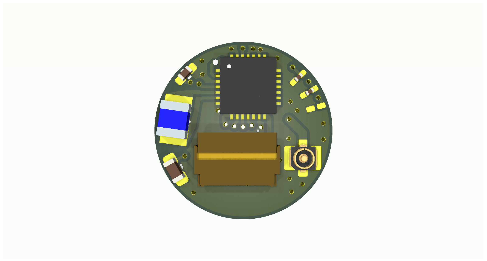

# SiSmaK Solar Energy Harvesting Module – Battery

Photovoltaic power-supply module developed for the existing **[SiSmaK](https://www.spp2305.de/sismak/)** sensor-integrated M20 bolt. The circular PCB connects through a **flexible printed circuit (FPC)** interface and supplies the existing electronics and rechargeable cell. The battery is on the SiSmaK electronics, not on this harvester PCB.

Development covered selection and configuration of the harvesting IC, schematic capture, PCB layout, and integration with the existing supply. Component placement was constrained by the approximately 13 mm board diameter and limited assembly height inside the bolt.

## Hardware Features

- **Energy Harvesting IC:** e-peas AEM10300
- **Energy Source:** Two series-connected ANYSOLAR KXOB25-05X3TF-TR cells
- **Operating Point:** Fractional open-circuit voltage tracking (FOCV), configured to 80% of open-circuit voltage
- **Energy Storage:** Existing EnerCera ET1210C-H rechargeable cell on the SiSmaK electronics
- **Power Management:** Inductive DC-DC conversion with configurable operating parameters
- **System Interface:** FPC connection to the existing SiSmaK electronics
- **Form Factor:** Compact circular PCB for space-constrained integration

### Photovoltaic Energy Harvesting

The AEM10300 was selected for its compact external circuit with one inductor and its cold-start characteristics. It charges the storage node; the existing SiSmaK step-up converter supplies the electronics. The 80% FOCV setting approximates the solar-cell datasheet MPP ratio used during design.

The thesis calls this a **Harvest–Use** architecture despite the battery buffer: the load remains connected during charging, so the harvester must support MCU startup when storage is depleted. ST_STO is routed to the existing electronics as a storage-status signal. In contrast, the capacitor variant delays connection of the load until sufficient energy has accumulated.

### SiSmaK Integration

The module was designed as an add-on to the existing SiSmaK electronics rather than a standalone development board. Its FPC interface provides the electrical connection to the sensor-integrating bolt system.

## PCB Design

The approximately 13 mm, four-layer PCB was designed in **KiCad 9**. Components and the FPC connector are placed on one side to reduce assembly height.

### PCB View

  

## Hardware Design Documentation

The KiCad schematic and PCB design files are included for further inspection.

[View Hardware Design Documentation (PDF)](Hardware_Design.pdf)

## Design Files

| File | Description |
|---|---|
| `Harvesting_Solar_Akku.kicad_pro` | KiCad project |
| `Harvesting_Solar_Akku.kicad_sch` | Electrical schematic |
| `Harvesting_Solar_Akku.kicad_pcb` | PCB layout |
| `images/Harvesting_Solar_Akku.png` | KiCad 3D rendering |
| `Hardware_Design.pdf` | Schematic and PCB documentation |

## Project Status

The thesis reports SMU output-load sweeps and integration tests of the battery-buffered supply (§4.3). Peak output reached approximately **11 mW under artificial illumination at 3800 K** and **just below 6 mW under the tested late-October sunlight**. SiSmaK measurement and wireless transmission operated under sufficiently strong artificial illumination; ordinary street lighting produced no received measurements.

A depleted cell could collapse under the initial MCU boot demand, causing repeated startup attempts. This limitation motivated the storage-controlled capacitor variant. The results are specific to the tested illumination and load conditions; an exact as-built PCB revision is not identified for each measurement.

---

**Author:** Alexander Richter  
**Institution:** TU Darmstadt  
**Related project:** [SiSmaK – Project Website](https://www.spp2305.de/sismak/)
