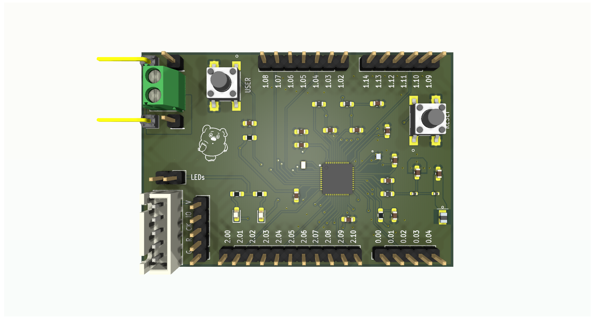

# nRF54L15 Custom Development Board

Custom-designed development board based on the **Nordic Semiconductor nRF54L15** microcontroller, developed for embedded firmware development, hardware prototyping, and peripheral testing.

The project covers schematic design, component selection, PCB layout, and integration of essential debugging and peripheral interfaces.

## Hardware Features

- **Microcontroller:** Nordic Semiconductor nRF54L15
- **Wireless Connectivity:** 2.4 GHz RF interface with an external antenna and discrete RF matching network
- **Clocking:** External high-frequency crystal oscillator
- **Power Supply:** Direct external supply with MCU decoupling and filtering.
- **Debugging:** SWD interface for programming and debugging
- **GPIO Expansion:** Pin headers providing access to MCU GPIOs and peripheral interfaces
- **User Interface:** Reset button, user button, and two status LEDs

### Debugging and Peripheral Access

The board provides SWD connections for firmware programming and debugging. Additional pin headers expose GPIO signals and configurable peripheral interfaces for external hardware integration.

Two LEDs and user-accessible buttons support firmware development and functional testing.

## PCB Design

The PCB was designed using **KiCad 9**, including schematic capture, component placement, and PCB routing.

### PCB Layout

  

## Schematics

The complete schematic is available as a PDF:

[View Schematic (PDF)](Hardware_Design.pdf)

The original KiCad project files are also included for further inspection.

## Design Files

| File | Description |
|---|---|
| [`MCU_Board.kicad_pro`](kicad/MCU_Board.kicad_pro) | KiCad project |
| [`MCU_Board.kicad_sch`](kicad/MCU_Board.kicad_sch) | Main schematic |
| [`MCU.kicad_sch`](kicad/MCU.kicad_sch) | MCU schematic sheet |
| [`MCU_Board.kicad_pcb`](kicad/MCU_Board.kicad_pcb) | PCB layout |
| [`MCU_Board.kicad_dru`](kicad/MCU_Board.kicad_dru) | Custom design rules |

## Project Status

Hardware design completed. Manufacturing and hardware validation status are not documented in this repository.

---

**Author:** Alexander Richter  
**Institution:** TU Darmstadt
