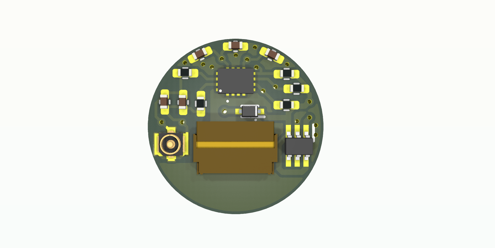

# SiSmaK NFC Energy Harvesting Module

NFC power-receiver module developed for the existing **[SiSmaK](https://www.spp2305.de/sismak/)** sensor-integrated M20 bolt. The circular PCB converts energy from an external reader field into a DC supply and connects to the existing electronics through an **FPC interface**.

Development covered harvesting-IC selection, reverse-current blocking, compact PCB layout, experimental antenna adjustment, and characterization of output power versus coil spacing and harvesting mode.

## Hardware Features

- **NFC IC:** NXP NTAG 5 Link (`NTP53121G0JHKZ` in the schematic and PCB)
- **Energy Harvesting:** NFC field energy converted to a DC output
- **Antenna Interface:** External antenna via MHF4 connector with tuning capacitors
- **Power Path:** LM66100 ideal-diode stage to block storage discharge into the harvesting output
- **System Interface:** FPC connection to the existing SiSmaK electronics, exposing power and control/data signals
- **Form Factor:** Compact circular PCB for space-constrained integration

### NFC Energy Harvesting

The NTAG 5 Link was selected for its energy-harvesting capability. The external antenna and tuning network feed the IC; the LM66100 then routes harvested energy toward the system while blocking reverse current. This is necessary because, without an NFC field, the tag pulls VOUT to ground and could otherwise discharge an attached energy buffer.

### SiSmaK Integration

The module uses an existing institute-developed antenna coil mounted on the bolt head. The harvesting PCB and power path are the thesis contribution; the coil and SiSmaK sensor electronics are the integration baseline. The FPC routes harvested supply, I²C, and event signals; these connections do not by themselves establish implemented NFC application firmware.

## PCB Design

The approximately 13 mm, four-layer PCB was designed in **KiCad 9**. Components are placed on the front, with additional measurement pads on the reverse for antenna adjustment.

### PCB View

  

## Schematics

The schematic includes the antenna tuning network, NTAG 5 Link, LM66100 output path, and FPC interface. 

## Hardware Design Documentation

The KiCad schematic and PCB design files are included for further inspection.

[View Hardware Design Documentation (PDF)](Hardware_Design.pdf)

## Design Files

| File | Description |
|---|---|
| `NFC_Harvester.kicad_pro` | KiCad project |
| `NFC_Harvester.kicad_sch` | Electrical schematic |
| `NFC_Harvester.kicad_pcb` | PCB layout |
| `images/NFC_Harvester.png` | KiCad 3D rendering |

## Project Status

The thesis reports tuning of the assembled receiver and SMU output-load sweeps (§§6.3–6.4). With identical facing coils, a CLRC663-plus reader, and a receiver on an aluminium M20 bolt head, maximum output reached about **40 mW at 1 cm** in high-field mode. Low-field mode produced about **22–23 mW over 0.5–1.5 cm**. The receiver sat above nonmetallic filling without ferrite.

---

**Author:** Alexander Richter  
**Institution:** TU Darmstadt  
**Related project:** [SiSmaK – Project Website](https://www.spp2305.de/sismak/)
